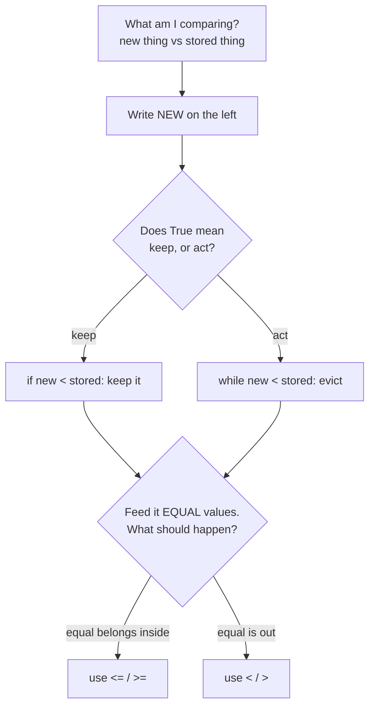

# Comparison direction

**In one line:** A comparison is not guessed and then flipped until the tests
pass — it is read off the invariant it protects, and the `=` half of it is
decided by one question about ties.

**Assumes you know:** the 18 patterns in `pattern_code/`. You can write the
shape of a binary search, a sliding window, and a monotonic stack, but stall on
the line inside the `while` — see `docs/daily_warmup.md`, which is where this
stall usually shows up.

**Not covered:** comparison in sorting (custom keys, comparators), floating
point `==`, and chained comparisons as a Python feature — see [Related](#related).

## ELI5

A bouncer at a door has one sentence written on a card: *"you may stay if you
are on the list."* Everything else follows. He does not decide per person
whether to eject them — he reads the card, and the card is written to describe
who belongs inside, never who gets thrown out.

Every comparison you struggle with is a card you haven't written yet. Write the
sentence describing what must be true of the things you are keeping, and the
operator is whatever spells that sentence.

**Where the analogy breaks:** in two places.

The card in real code is often written from the *opposite* side. A `while`
loop's condition describes who is being ejected — `while stack and temps[top] <
t: pop` says "eject while the top is colder." Same card, negated, because the
loop body is the ejection. If you write the keep-sentence and then find yourself
writing a `while`, negate once, deliberately, and say the negated sentence out
loud before typing it.

And the bouncer has no opinion on someone standing exactly in the doorway. Your
comparison must. Ties are the only thing `<` and `<=` disagree about, so they
are the only thing worth thinking about once the direction is settled.

## Actually

Three questions, in this order. Answering them out of order is what produces
the flip-until-green loop.

    1. direction   Which variable is the NEW thing, which is the STORED thing?
                   Write the new one on the left. This alone fixes < vs >.
    2. sense       Does True mean keep/continue, or does True mean act/evict?
                   A `while` almost always means act; an `if` usually means keep.
    3. ties        Feed the two sides EQUAL values by hand. Decide what should
                   happen. That answer, and only that, picks < vs <=.

Question 1 is mechanical and you can always answer it. Question 3 is where the
real bugs are, and it is answerable in about ten seconds — the equal case is a
single concrete scenario, not a proof.

The reason this works is that a maintained structure always has an invariant
comment above it, and the invariant is the keep-sentence already written down:

    # invariant: indices awaiting an answer, temperatures decreasing
    while stack and temps[stack[-1]] < t:      # a colder top breaks "decreasing"

The condition is just the invariant's violation, spelled as code. When you
cannot derive the comparison, the real problem is that you have not stated the
invariant — go write that line first and the operator falls out.

## The picture



Note that the tie question is asked *last* and applies to both branches. It is
independent of direction, which is why deciding it first tangles the two.

## Example 1 — the smallest thing that works

```python
best = 0
for x in nums:
    if x > best:        # keep-sentence: "best is the largest seen so far"
        best = x
```

Ties: `x == best` changes nothing, so `>` and `>=` are both correct here. When
the tie case is a no-op, stop thinking about it — this is the majority of
running-max and running-min code, and it is why those never feel hard.

The moment the body has a side effect beyond the assignment, the tie stops being
free:

```python
best = 0
best_index = -1
for i, x in enumerate(nums):
    if x > best:        # `>` keeps the FIRST maximum
        best = x
        best_index = i  # `>=` would keep the LAST one instead
```

One character, and the returned index changes. Same values, same maximum.

## Example 2 — the version you'll actually write

`merge_intervals` (`pattern_code/08_greedy.py:41`), the one that stalls people
mid-warmup:

```python
for start, end in intervals[1:]:
    if start <= merged[-1][1]:             # starts before current block ends
        merged[-1][1] = max(merged[-1][1], end)
    else:
        merged.append([start, end])
```

Walk the three questions.

    direction  new = `start` (this interval), stored = `merged[-1][1]` (the
               end of the block being extended). New on the left: `start ? end`.
    sense      An `if` choosing between merge and append — True means "merge",
               so the keep-sentence is "this interval touches the block."
    ties       `[1,3]` then `[3,5]`. Do they merge? LC 56 says yes — touching
               counts as overlapping. So equal is inside: `<=`.

Note what the tie question is really asking: it is a *problem-statement*
question, not a code question. The answer is in the prompt ("intervals `[1,4]`
and `[4,5]` are considered overlapping"), never in the code you are writing. If
you cannot answer it from the prompt, that is the clarifying question to ask
your interviewer, and asking it scores.

Change nothing but that one character and you produce `[[1,3],[3,5]]` instead of
`[[1,5]]` — a wrong answer that passes every test case without a shared endpoint.

## Example 3 — where it gets subtle

Three places in this repo where the tie decides the whole problem.

**Binary search: `lo < hi` vs `lo <= hi`.** These are not preferences, they
belong to different invariants:

    lo, hi = 0, len(nums)       half-open [lo, hi). Empty means lo == hi,
    while lo < hi:              so the loop must STOP at equal. `09:41`

    lo, hi = 0, len(nums) - 1   closed [lo, hi]. lo == hi is a live candidate
    while lo <= hi:             still to be tested, so keep going. `09:120`

Pair the operator to the bracket, never to habit. Mixing them either skips the
last candidate or loops forever.

**Monotonic stack: `<` vs `<=` on the pop test.** `daily_temperatures`
(`pattern_code/10_stack.py:70`) pops on `temps[stack[-1]] < t`, strictly. A day
of equal temperature is not warmer, so it must *not* be popped — the problem
asks for strictly warmer. Flip it to `<=` and equal days get answered with
`i - j`, and every duplicate temperature reports a wrong distance.

The same file's other problems flip this deliberately. `<` vs `<=` on a
monotonic stack is exactly the strict-vs-non-strict distinction in the problem
statement, and there is nothing else to reason about.

**Sliding window: which side is the loop testing?** These two look alike and
shrink for opposite reasons:

    while total >= target:      shrink while VALID   — hunting the shortest
                                (`02_sliding_window.py:83`, LC 209)

    while <window invalid>:     shrink while INVALID — hunting the longest
                                (LC 3, LC 424)

Ask "shortest or longest?" before writing the `while`, because that word alone
sets the sense. Getting it backwards gives a loop that either shrinks to empty
or never shrinks at all — and both still run, silently returning garbage.

## Traps

    flipping to fix         Changing `<` to `<=` because a test failed, without
                            naming the tie it changed, fixes one case and breaks
                            an untested one. Re-derive instead; it takes longer
                            to flip-and-rerun than to answer the tie question.
    the negation            `if keep` and `while evict` hold opposite conditions.
                            Copying a condition from an `if` into a `while`
                            without negating is the most common paste bug here.
    stale operand order     After a refactor swaps which variable is "new", the
                            operator must flip too. `a < b` with the roles
                            reversed is `b < a`, not `a > b` — those differ on ties.
    `max` hiding a tie      `max(x, y)` and `x if x > y else y` differ when the
                            two are equal objects, not just equal values. Only
                            bites when you keep an index or a reference alongside.
    strict on a float       `<` and `<=` are the same question on floats you
                            computed rather than read. Compare with a tolerance
                            or compare integers; this repo's problems are all
                            integer, which is why it never comes up here.
    off-by-one from `-1`    `hi = len(nums) - 1` and `hi = len(nums)` demand
                            different loop operators AND different `hi = mid`
                            updates. Change one, change all three.

## Drill

Ten blanks, no reference files open. For each, write the operator *and the
one-sentence reason*. The sentence is the drill — an operator alone is a coin
flip you got right.

    1.  merge intervals, touching endpoints count as overlap: `start __ prev_end`
    2.  merge intervals, touching endpoints do NOT count:     `start __ prev_end`
    3.  binary search over `[lo, hi)`:                        `while lo __ hi`
    4.  binary search over `[lo, hi]`:                        `while lo __ hi`
    5.  lower_bound's step, mid is too small to be the answer: `if nums[mid] __ target`
    6.  next STRICTLY warmer day, pop test:                   `while temps[top] __ t`
    7.  next warmer-or-equal day, pop test:                   `while temps[top] __ t`
    8.  size-k min-heap, newcomer joins the elite:            `if x __ heap[0]`
    9.  LC 3, a previous sighting is still inside the window: `if last_seen[ch] __ left`
    10. LC 55, this index is unreachable:                     `if i __ farthest`

Then the harder half — say what breaks, in one sentence, if the operator flips:

    11. LC 209 `while total >= target` becomes `>`
    12. LC 215 `if x > heap[0]` becomes `>=`
    13. LC 739 `while temps[top] < t` becomes `<=`
    14. LC 56 `if start <= prev_end` becomes `<`

### Answers

    1.  `<=`  equal endpoints touch, and touching is defined as overlapping
    2.  `<`   equal endpoints no longer qualify; `[1,3]` and `[3,5]` stay apart
    3.  `<`   `lo == hi` is the empty range — nothing left to test
    4.  `<=`  `lo == hi` is one untested candidate
    5.  `<`   `nums[mid] == target` could BE the answer, so it must survive
              into `hi = mid` — that is what makes it lower, not upper, bound
    6.  `<`   equal is not warmer, so an equal top keeps waiting
    7.  `<=`  equal now counts as an answer, so it gets popped
    8.  `>`   equal does not beat the weakest; evicting on a tie is wasted work
              and, for LC 215's duplicates, returns the same value anyway
    9.  `>=`  `last_seen[ch] == left` is the char AT the window's left edge —
              still inside, so left must move past it
    10. `>`   `i == farthest` is reachable (it is the farthest reachable index);
              only strictly beyond it is unreachable

    11. Shrinks one step too far — it drops the element that made the window
        valid, so `best` records a length that never satisfied the target.
    12. Correct output, wasted work: every tie triggers a heapreplace that
        swaps a value for an identical one. O(log k) per duplicate, for nothing.
    13. Every run of equal temperatures reports the distance to the next EQUAL
        day instead of 0-or-warmer. Wrong on any input with a repeated temp.
    14. `[[1,3],[3,5]]` instead of `[[1,5]]`. Invisible until a test shares an
        endpoint, which the LeetCode samples for 56 happen not to.

Anything you got right without being able to say the sentence counts as wrong.
The operator has a 50% floor; the sentence does not.

## Related

- `docs/concepts/monotonic-stack.md` — the `<` vs `<=` distinction as the
  strict/non-strict axis of an entire pattern family
- `pattern_code/09_binary_search.py` — the module docstring on invariant-first
  boundary discipline, and where the monotonicity tell lies
- `docs/daily_warmup.md` — Day 2's note on knowing which direction the window
  condition is monotone in before writing the `while`
- `pattern_code/19_fallbacks.py:442` — LC 35's linear fallback: the same tie
  question ("first index >= target") with the binary search stripped away
