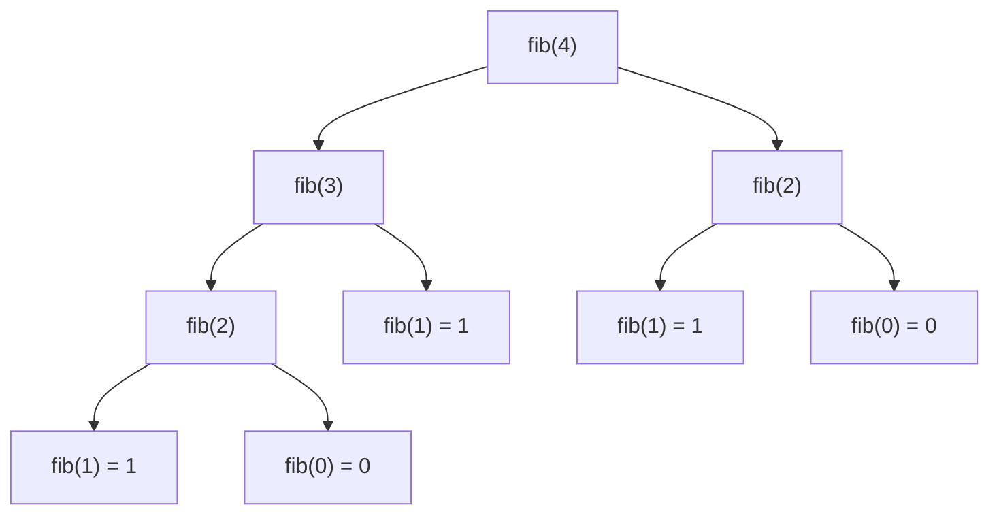

# Recursion

**In one line:** A function solves a big problem by calling itself on a smaller
version of the same problem, until the version is small enough to answer outright.

**Assumes you know:** Python functions, arguments, return values. You have
already written recursive code (`merge_sort`, `maxDepth`) and want to know why
it works and where it bites.

**Not covered:** Converting recursion to an explicit-stack loop, and memoization
as a technique — see [Related](#related).

## ELI5

You are standing in a line and want to know your position. You do not count the
whole line. You tap the person ahead of you and ask "what position are you?",
then add 1 to their answer. They do the same. The person at the very front
doesn't ask anyone — they know they're #1 — and that answer travels back down
the line until it reaches you.

**Where the analogy breaks:** in two places.

Real people cost nothing to leave waiting. Your program holds a stack frame in
memory for every person still waiting for an answer, and Python quits at ~1000
of them with `RecursionError`.

And a line is one chain. Most recursion you write branches — `maxDepth` asks two
people, backtracking asks one per remaining choice. The picture is a tree of
pending questions, not a queue, which is why a function only 20 calls deep can
still make a million calls.

## Actually

A recursive function has three parts:

    base case        returns without calling itself. At least one, and it must
                     be reachable from every input
    recursive case   calls itself on strictly smaller input — smaller list,
                     shallower subtree, one fewer choice
    combine          turns the answers it got back into its own answer

Correctness is proof by induction, and you can check it locally: if the base
case is right, and the recursive case is right *assuming the child calls return
correct answers*, the function is right. You never trace the whole thing. This
is the actual payoff of recursion — you reason about one level.

Cost is two separate numbers, and conflating them is the usual mistake:

    depth      longest chain of pending calls → memory (one frame each)
    node count total calls in the call tree   → time

For `maxDepth` on a balanced tree, depth is `log n` and node count is `n`. For
naive `fib`, depth is `n` but node count is about `2^n`.

## The picture



The call tree for `fib(4)`. Depth is 4; node count is 9. `fib(2)` is computed
twice from scratch — that duplication is what makes naive `fib` exponential and
what a memo dictionary removes.

## Example 1 — the smallest thing that works

```python
def countdown(n):
    if n == 0:            # base case: answer outright
        return []
    return [n] + countdown(n - 1)   # recursive case + combine

print(countdown(5))       # [5, 4, 3, 2, 1]
```

One recursive call per level, so the call tree is a straight line: 5 frames
stacked, then each returns and the `+` builds the list on the way back down.
Note that `n - 1` is strictly smaller, and `0` is reachable from any positive
`n` — that pair is what guarantees it terminates.

## Example 2 — the version you'll actually write

`dfs/maxdepth_of_binarytree.py:9`:

```python
class Node:
    def __init__(self, val):
        self.val = val
        self.left = None
        self.right = None

def maxDepth(root: Node) -> int:
    if root is None:
        return 0

    left = maxDepth(root.left)
    right = maxDepth(root.right)

    return max(left, right) + 1

root = Node(1)
root.left = Node(2)
root.right = Node(3)
root.left.left = Node(4)

print(maxDepth(root))     # 3
```

**Adds:** two recursive calls instead of one, so the call tree branches. The
combine step now has real work in it — `max(left, right) + 1` — and this is
where you apply the induction argument: assume `left` and `right` are correct
depths, and the line is obviously right. You never trace both subtrees in your
head.

The base case `root is None` returning `0` is doing double duty: it terminates
the recursion *and* it is the identity for `max`, so an empty child never wins.

## Example 3 — where it gets subtle

`Backtrack.py:13`:

```python
def combine(nums, k):
    res = []

    def backtrack(start, path):
        if len(path) == k:
            res.append(path.copy())   # snapshot — see below
            return
        for i in range(start, len(nums)):
            path.append(nums[i])      # choose
            backtrack(i + 1, path)    # explore
            path.pop()                # un-choose

    backtrack(0, [])
    return res

print(combine([1, 2, 3, 4], 2))
# [[1, 2], [1, 3], [1, 4], [2, 3], [2, 4], [3, 4]]
```

**Adds:** the recursive calls now share one mutable `path` list instead of
passing values back up. Two things follow, and both are bugs if you miss them.

`path.pop()` after the call is mandatory. `path` is not restored for you when a
frame returns — only the local names are. Delete the `pop()` and `path` keeps
growing across sibling branches, so you get `[1,2,3,4]` instead of `[1,2]`.

`path.copy()` is mandatory for the same reason. `res.append(path)` stores a
reference to the one list that every frame is mutating; by the time `combine`
returns, all six entries are the same empty list.

The alternative is to pass a fresh list down — `backtrack(i + 1, path + [nums[i]])`
— which needs no `pop()` and no `copy()`, at the cost of allocating a list per
node. Both are correct; the mutate-and-undo version is what you write when the
path is large.

## Gotchas

- **Base case unreachable, not missing** — `if n == 0` with `n` counting down by
  2 from an odd number sails past it into `RecursionError`. Prefer `if n <= 0`.
  `merge_sort` uses `len(arr) <= 1` for this reason, not `== 1`.

- **Base case returns a type the recursive case can't consume** —
  `dfs/fundamentals.py:18` returns `float('-inf')` from the base case, then line
  25 does `left.val` on it. `left` is a number, not a `Node`. The rule: whatever
  the base case returns must be the same shape as what the recursive case
  returns, because the combine step can't tell them apart.

- **`def fib_hash(n, memo={})`** (`DP_fib.py:15`) — the default dict is created
  once at function definition and shared by every top-level call, forever. It
  happens to be harmless for `fib`, whose answers never change, and silently
  wrong for anything keyed on data that does. Use `memo=None` plus
  `if memo is None: memo = {}`, or `@functools.cache`.

- **Shallow does not mean cheap** — naive `fib(35)` is 20 frames deep and makes
  ~30 million calls. Depth is the memory bound; node count is the time bound.
  Count nodes when you estimate runtime.

- **Python caps depth at ~1000 and has no tail-call optimization** — recursing
  down a 10,000-node linked list crashes, and rewriting it so the recursive call
  is the last expression does not help. Python builds a frame regardless. That
  input size is where you switch to a loop.

- **Slicing inside recursion copies** — `merge_sort(arr[:mid])` at
  `MergeSort.py:6` allocates a new list at every level, making the algorithm
  O(n log n) in space. Passing `(lo, hi)` indices instead keeps it O(log n).

## Where to practice

Three files in `pattern_code/`, in the order this page teaches them.

**`03_trees.py` — pure recursion.** Example 2 generalized: same skeleton, an
escalating combine step. Start here.

    max_depth:251            Example 2 verbatim (LC 104)
    is_same_tree:106         two arguments, base case has to cover both
    invert_tree:124          combine mutates instead of returning a value
    height:280               diameter — returns one thing, records another via nonlocal
    gain:306                 max_path_sum — same skeleton as diameter; do them back to back
    dfs:331                  rob_tree — combine returns a tuple
    lca:367                  base case returns a node, not a number
    build:155                recursion over index ranges, not over subtrees
    dfs:402 / dfs:423        serialize / deserialize — recursion in both directions

`dfs:331` and `lca:367` are where "assume the child calls are correct" stops
being obvious and you have to actually state the invariant.

**`07_backtracking.py` — Example 3, ten times.** Every problem is the
choose / explore / un-choose template.

    dfs:25                   subsets — the minimal template
    dfs:102                  permutations — state is a used[] array, not a start index
    dfs:216                  generate_parenthesis — two recursive calls, both guarded
    dfs:242                  word_search — un-choose restores the board, not a path
    dfs:274                  solve_n_queens — three parallel structures to undo
    dfs:312                  partition_palindromes — the choices are string slices

`word_search` and `solve_n_queens` punish a missing un-choose in a way `subsets`
does not: with one shared board, a forgotten restore corrupts branches you have
not visited yet.

**`04_graphs.py` — where "smaller problem" stops being smaller.** This is the
DFS bullet in [Related](#related) made concrete.

    sink:28                  num_islands — mutates the grid as the visited set
    dfs:163                  course schedule — three-color, GRAY = on the current path
    dfs:265                  clone_graph — memo insert BEFORE recursing, for cycles
    dfs1:451                 SCC — postorder as finish time
    dfs:501                  bridges — carries parent to skip the trivial back-edge

`dfs:265` is the direct answer to why graphs need `visited` and trees do not.

Two one-offs worth a look: `15_design.py:212` backtracks over a trie for `.`
wildcards, and `12_linked_list.py:75` (`reverse_k_group`) recurses to get the
finished remainder before stitching.

**Gap:** `05_dp.py` is 27 functions of bottom-up iteration with no `memo`
anywhere, so the memoization bullet below has no target in `pattern_code/`. Use
`DP_fib.py` for that.

## Related

- **Memoization / dynamic programming** — recursion plus a cache on the
  arguments. It collapses the duplicated subtrees in the picture above; see
  `DP_fib.py` for both the recursive and bottom-up forms.
- **Backtracking** — recursion where the recursive case is a loop over choices,
  with state undone on the way out. Example 3 is the template.
- **Divide and conquer** — recursion where the subproblems are disjoint and the
  combine step is the expensive part (`MergeSort.py`, `QuickSort.py`).
- **DFS** — recursion whose "smaller problem" is a subgraph. Needs a `visited`
  set, unlike trees, because the smaller problem isn't guaranteed smaller.
- **Iteration with an explicit stack** — the same traversal with the frames in a
  list you control. Use it when depth would exceed the recursion limit.

## Sources

- Python docs, `sys` module — `sys.setrecursionlimit` and `sys.getrecursionlimit`:
  https://docs.python.org/3/library/sys.html#sys.setrecursionlimit
- SICP, section 1.2.1 "Linear Recursion and Iteration" — the recursive-process
  vs iterative-process distinction, and why Python lacks the latter.
- CLRS, section 2.3.2 "Analyzing divide-and-conquer algorithms" — turning a call
  tree into a recurrence and solving it.
